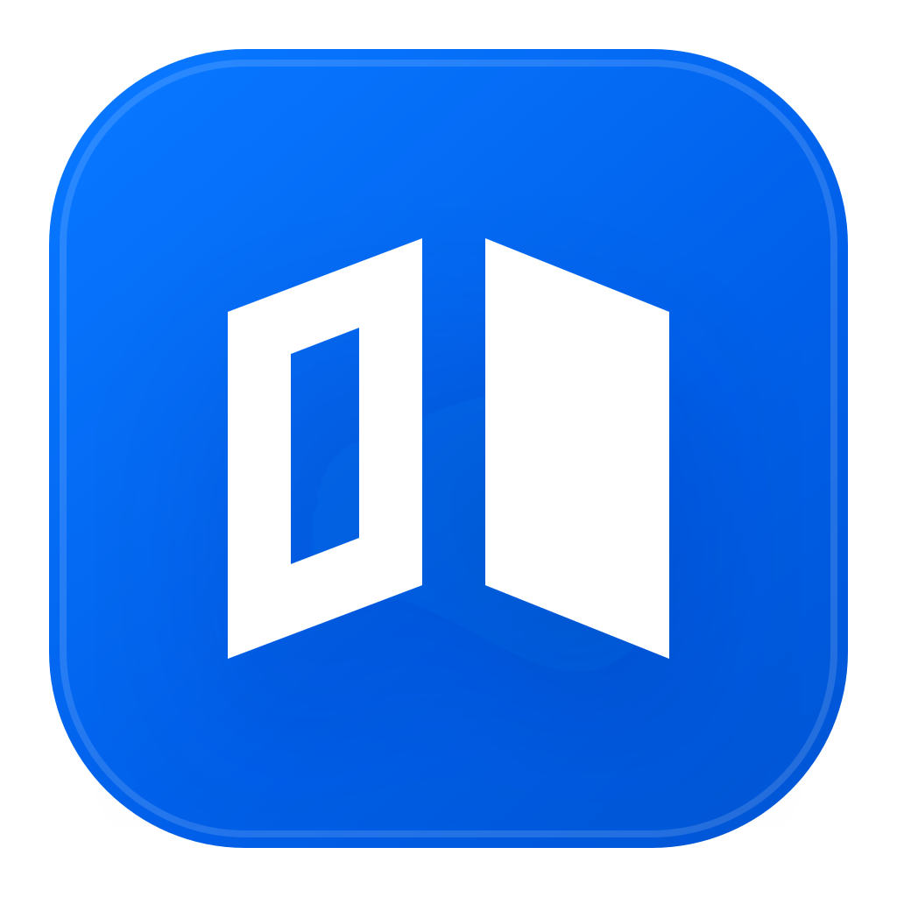
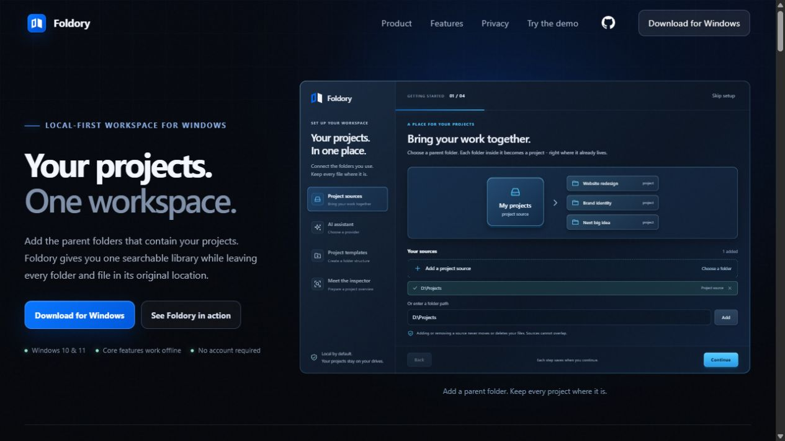

<p align="center">
  
</p>

<h1 align="center">Foldory</h1>

<p align="center">
  <strong>Your projects. One workspace.</strong><br>
  A local-first desktop workspace for the project folders already on your Windows PC.
</p>

<p align="center">
  <a href="https://foldory.reflect.ba/"><strong>Website</strong></a>
  &nbsp;&middot;&nbsp;
  <a href="https://foldory.reflect.ba/interactive/"><strong>Interactive demo</strong></a>
  &nbsp;&middot;&nbsp;
  <a href="https://foldory.reflect.ba/Foldory_1.2.2_x64-setup.exe"><strong>Download for Windows</strong></a>
  &nbsp;&middot;&nbsp;
  <a href="#development"><strong>Development</strong></a>
</p>

<p align="center">
  Windows 10/11 &nbsp;&bull;&nbsp; Core features work offline &nbsp;&bull;&nbsp; No account required
</p>

<p align="center">
  <a href="https://foldory.reflect.ba/">
    
  </a>
</p>

## One home for every project folder

Foldory turns the folders you already use into a searchable project library. Add a parent directory and each immediate child folder becomes a project—without moving, renaming, or uploading anything.

Use it to browse project files, keep metadata, search across your work, edit documents, inspect Git activity, and open projects in the tools you already use.

## Highlights

- **Keep your existing structure.** Work directly with folders on your local drives.
- **Find anything quickly.** Search project names, paths, file names, and indexed text with `Ctrl K`.
- **Read and edit in place.** Preview Markdown, images, CSV, Excel, and Word files; edit supported text files with autosave and conflict checks.
- **Stay close to your tools.** Open projects in Explorer, PowerShell, Command Prompt, Cursor, Claude, Codex, or a custom launcher.
- **See project context.** View the current Git branch, working-tree status, and recent commits without changing the repository.
- **Choose how AI is used.** Connect local models, installed CLIs, or API providers and explicitly control which project files they can access.

## Local by default

The project library, search index, editor, and file tools run locally. Foldory does not require an account and does not move project files into its own storage.

AI features are optional. When enabled, only the context you approve is sent to the provider you select. API keys are stored in Windows Credential Manager, while sensitive paths are excluded from search and AI context by default.

## Install

Download the verified installer for **Windows 10 or 11 (64-bit)**:

**[Download Foldory 1.2.2](https://foldory.reflect.ba/Foldory_1.2.2_x64-setup.exe)**

Microsoft Edge WebView2 Runtime is required. The installer offers to download it automatically when it is not already available.

Git for Windows is optional and only needed for the Git panel. Word or LibreOffice is optional and only needed for visual Word parsing. AI providers and coding-agent CLIs are optional integrations.

## How it works

```text
React interface  ->  Tauri commands  ->  your project folders
                           |
                           +-> SQLite library and search index
                           +-> Windows Credential Manager (API keys)
```

The webview cannot access the filesystem or shell directly. Native Rust commands validate project paths, keep file operations inside registered projects, and perform atomic revision-checked saves.

## Development

### Prerequisites

- [Node.js](https://nodejs.org/) LTS with npm
- [Rust](https://www.rust-lang.org/tools/install) stable
- Microsoft C++ Build Tools with MSVC and the Windows SDK
- [Microsoft Edge WebView2 Runtime](https://developer.microsoft.com/microsoft-edge/webview2/)

### Run locally

```powershell
npm ci
npm run tauri dev
```

### Quality checks

```powershell
npm test
npm run test:e2e
cargo test --manifest-path src-tauri/Cargo.toml
npm run format:check
```

### Build the installer

On Windows, double-click `build_release.bat` to run every test and privacy check,
build the release, copy both publishable files into `releases/<version>-clean`,
print their SHA-256 hashes, and open that folder in Explorer. For an unattended
run that does not open Explorer, use `build_release.bat --no-open`.

The equivalent manual workflow is:

```powershell
npm ci
npm test
cargo test --manifest-path src-tauri/Cargo.toml
npm run format:check
$env:FOLDORY_SKIP_OPEN_BUILD = "1"
npm run tauri build
npm run privacy:check
Get-FileHash -Algorithm SHA256 `
  src-tauri/target/release/foldory.exe, `
  src-tauri/target/release/bundle/nsis/Foldory_1.2.2_x64-setup.exe
```

The release executable is written to `src-tauri/target/release/foldory.exe`, and the NSIS installer is written to `src-tauri/target/release/bundle/nsis/`.

Always build through `npm run tauri build`. The wrapper remaps local source and
user-profile paths, strips native symbols, removes PDB files, and fails the build
if a release artifact still contains a developer username or build-machine path.
Calling Cargo or the Tauri CLI directly bypasses these release protections.

Publish only the final executable or installer, never the full `target` directory.
Record the SHA-256 hashes and confirm that a downloaded copy of each published
artifact has the same hash before linking it publicly.

## Tech stack

- [Tauri 2](https://tauri.app/) and Rust for the native application layer
- React 19 and TypeScript for the interface
- SQLite with FTS5 for local metadata and search
- CodeMirror 6 for text and code editing
- Vitest, Testing Library, and Playwright for automated checks

## Current scope

Foldory is currently a single-user Windows application. Git support is read-only, cloud sync is not included, and the Assistant can only write approved UTF-8 text files inside the active project. Project folders should still be backed up normally.

---

<p align="center">
  Built by <a href="https://reflect.ba/">Reflect</a>.
</p>
